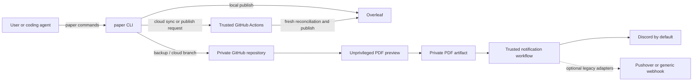

# paper-scripts

`paper` is a small command layer for writing LaTeX papers across a laptop,
Codex, GitHub, and Overleaf. You work in terms of **start**, **commit**,
**backup**, **sync**, **preview**, **notify**, and **publish**. Git branches,
remotes, CI jobs, credentials, and reconciliation rules stay implementation
details until they need attention.

The core promise is simple:

- `paper commit` makes a local checkpoint.
- `paper backup` copies committed work to GitHub and never touches Overleaf.
- `paper publish` is the explicit boundary that makes work collaborative on
  Overleaf.

## Architecture



The system is designed around five goals:

1. **One user-facing interface.** Local users and agents use `paper`; they do
   not improvise lifecycle Git commands.
2. **Explicit publication.** GitHub backup and PDF preview cannot publish to
   Overleaf.
3. **Fresh reconciliation.** Sync and publish fetch both remotes and refuse
   unsafe divergence.
4. **Narrow secrets.** Cloud agents never receive the Overleaf token or a
   notification webhook.
5. **Reviewable upgrades.** Every paper vendors a versioned runtime and
   generated workflows. `paper init` updates them conservatively.

## Repository model

A normal paper has a collaborative base branch—usually `main` or `master`—and
short-lived feature branches:

```text
overleaf/<base>    collaborative source of the paper
github/<base>      private mirror and trusted workflow source
github/<feature>   isolated work and backup
```

The base branch is discovered or configured; it is not hard-coded. A local
checkout normally has `github` and `overleaf` remotes. A cloud checkout needs
only GitHub access because privileged GitHub Actions owns Overleaf access.

Generated infrastructure inside a paper looks like this:

```text
AGENTS.md                              paper and agent instructions
.paper/config.json                    non-secret paper settings
.paper/manifest.json                  generated-file version and hashes
.paper/WORKFLOW.md                     concise lifecycle contract
.paper/runtime/                        pinned paper-scripts runtime
.github/workflows/paper-preview.yml    unprivileged PDF build
.github/workflows/paper-notify.yml     trusted notifications
.github/workflows/paper-publish.yml    trusted sync/publication
notes/                                 reusable research knowledge
tasks/                                 resumable task records
```

The runtime is vendored so a CI run never downloads a moving copy of
`paper-scripts`. Updating this tooling repository does not silently change any
paper; each paper is upgraded with `paper init`, reviewed, and committed.

## Command model

| Command | Meaning |
| --- | --- |
| `paper start NAME` | Synchronize the base, create `NAME`, and immediately back it up to GitHub. |
| `paper commit "MESSAGE"` | Stage the paper repository and create a local checkpoint. Push nowhere. |
| `paper backup` | Push the current committed branch to GitHub. Never touch Overleaf. |
| `paper sync` | Reconcile GitHub and Overleaf into the local base. Run from a clean base branch. |
| `paper publish` | Reconcile fresh state, integrate committed work, back it up, and publish to Overleaf. Requires explicit authorization. |
| `paper init [--poster \| --slides] [--force]` | Initialize or upgrade conservatively; scaffold blank sources. Explicit --force reinstalls starter paths with backups. |
| `paper create [--poster \| --slides] [--force] OVERLEAF_ID OWNER/REPO [DIRECTORY]` | Create a new private GitHub/Overleaf paper, poster, or slides repository and then run `paper init`. |
| `paper notify --title TITLE --message MESSAGE [--url HTTPS_URL]` | Dispatch the trusted notification workflow. The URL becomes a clickable Discord embed title. |
| `paper notify-test` | Test the configured provider through GitHub Actions. |
| `paper configure-ci [--environments-only]` | Create/verify protected environments and privately install the Overleaf credential. |
| `paper configure-notifications [--provider PROVIDER] [OWNER/REPO ...]` | Configure this paper from its `github` remote, or explicitly configure multiple papers. Discord is the default. |
| `paper build [--watch] [ROOT.tex]` / `paper clean [ROOT.tex]` | Build or clean in `output/`; default `main.tex`. Watch mode rebuilds after saves. |
| `paper view [ROOT.tex]` | Build and open the current PDF in Reader, Evince, or the system viewer. |
| `paper status [--verbose]` / `paper doctor` | Inspect manuscript synchronization, GitHub backup, configuration, and tools. Verbose status adds raw history counts. |
| `paper abort` | Confirm and delete the current feature locally and on GitHub. Never touch the base or Overleaf. |
| `paper clear-feature-branches` | Confirm and delete all non-base branches locally and on GitHub. |
| `paper task status [--all]` / `paper task delete ID ...` | Inspect or recoverably remove task records. |
| `paper open [--terminal \| --vscode]` | Open the repository in Kitty/Micro or VS Code; no remotes required. |

Run `paper help` for the complete command reference and `paper examples` for
compact workflows.

### Local editor workspaces

`paper open` uses the editor selected in Git configuration. The personal terminal
profile sets `terminal`; installations without a selection fall back to VS Code.
Select an editor explicitly, or change the personal default:

```bash
paper open --terminal                 # Editor + build watcher + external Reader
paper open --vscode                   # VS Code in a new window
git config --global paper.editor terminal
git config --global paper.editor vscode
```

A repository-local `git config paper.editor terminal` overrides the global
setting. `PAPER_EDITOR=terminal paper open` overrides both; explicit flags take
precedence. No project files or remotes are changed when opening a repository.

For any directory, including projects without Git, use `project-open /path/to/project`.
It defaults to the terminal workspace and also accepts `--vscode`. Terminal mode
requires Kitty and Micro on `PATH`; VS Code mode requires `code`. Install these
separately. Micro's optional Filemanager2 plugin provides a project file tree;
enable `filemanager2.openonstart` in Micro's settings to show it at launch.

The project window inherits your Kitty theme. Click to focus either pane, use
Ctrl+Alt+arrow to move between panes, Ctrl+Shift+Z to zoom/restore the active
pane, Ctrl+Shift+R to resize, and Ctrl+Shift+Enter to add a shell split in the
current directory. These overrides apply only to project windows. PDFs stay
external: Reader is preferred when installed, with Evince/system-viewer fallback.

Paper terminal workspaces also start a **Build** tab, which watches the configured
`root_tex` (`main.tex` by default) and its dependencies. Save a document source to rebuild automatically; compilation
errors appear in that tab. It leaves the editor and project shell available.
Ctrl+C in Build stops the watcher. Opening another workspace for the same source
reuses the existing watcher instead of starting a duplicate. Reopening an existing
Editor also restores a missing watcher (for example, after opening the folder
standalone with `workspace-edit`).

Ctrl+` (backtick) toggles the bottom terminal from either pane, preserving its
shell/jobs and the resized split. The same interface is available as
`project-terminal toggle [--show | --hide] [--workspace ID]`; Micro also provides
Ctrl+E then `terminal`. Drag the horizontal pane divider to adjust its height
with a recent Kitty (native support); Ctrl+Shift+R remains the keyboard fallback.
The optional pinned `workspace-kitty` supplied by the personal profile is used for
Editor windows when installed. `PROJECT_KITTY=/path/to/kitty` overrides that choice;
otherwise the regular `kitty` is used. Other Kitty applications are unaffected.

### Independent Editor and Reader

`workspace-edit DIRECTORY` opens a normal project workspace; pass file paths to
open those files, or `--line N --column N FILE` to navigate to a source location.
An unambiguous existing editor is reused and preserves unsaved buffers. Use
`workspace-edit list --json`, `--session ID`, or `--new` to select another window.
`workspace-edit view FILE --line 42 --end-line 48 --top-line 36 --highlight`
reveals a range without changing source text or creating a destructive selection.
`--focus` also focuses the managed Kitty pane; `--reveal` switches its terminal tab
without taking desktop focus. Omit line coordinates to retain the file's cursor.

Use `workspace-edit status FILE --json` for fresh open-buffer state: `modified`,
`disk_changed`, read-only status, cursor/scroll position and a content `version`.
The personal Micro profile automatically reloads clean files after external edits,
including inactive tabs. Unsaved buffers remain intact. `workspace-edit reload FILE`
refuses to discard them; an explicitly authorized discard additionally requires
`--discard --expected-version HASH` from a fresh status response. A changed hash
rejects the discard. `--if-open` and `--if-clean` allow guarded source-link actions.
The extended controls require protocol 2; older running editors stay untouched
until reopened. `workspace-edit reload-ui --project ROOT --session ID` queues
an in-place plugin/theme/syntax reload on the native editor event loop; document
buffers and undo history remain in memory. The personal profile also reloads
automatically when its installer publishes a complete runtime generation.
Only explicit file/view/status/reload/reload-ui messages are accepted.
`project-open` and `paper open` also accept `--file`, `--line`, `--session`, and
`--new`. `paper open --no-reader` leaves the reader launch disabled.

The optional standalone Reader lives in
[workspace-reader](https://github.com/m1gwings/workspace-reader). Both apps have
separate launchers/icons supplied by the personal profile. Reader and Editor
share a project/session identity but can close independently. Personal Micro
integration supplies F7 Preview/forward SyncTeX, F8 manuscript PDF, and PDF
Ctrl+click for inverse SyncTeX; its implementation stays outside Paper Scripts.

When `workspace-layout` is installed, a new paper workspace can request ordinary
COSMIC tiling: Editor on the laptop (dock visible), Reader left/Codex right on the
external display. The adapter verifies monitor membership and reports when exact
tile geometry is unavailable. Set `WORKSPACE_AUTO_LAYOUT=0` to skip placement.
Reusing a workspace preserves its current placement. Neither adapter is required
for the launchers or the legacy viewer fallback.

### Add terminals to an existing project window

Project Kitty windows expose a private local Unix socket, with control accepted
only through that socket. This applies only to windows opened by `paper open`
or `project-open`; other Kitty windows keep their own configuration.

```bash
project-terminal list
project-terminal run --project /path/to/paper --title Experiments \
  --cwd /path/to/experiment -- /path/to/experiment/.venv/bin/ews run experiment.yml --output outputs
project-terminal run --project /path/to/paper --title 'SSH · server' -- ssh server
project-terminal run --project /path/to/paper --title Shell
```

The default is a new tab in that existing desktop window. Use `--split` to add
a split to its editor tab; `--tab ID` targets another listed Kitty tab. Tabs are
named and remain manually usable. A command runs with its literal argument list
and leaves an interactive Bash shell when it exits. For a pipeline or other shell
syntax, explicitly pass `-- bash -lc 'YOUR COMMAND'`. Choose the appropriate
environment/executable for the task. `--keep-focus` leaves the current view active.

The helper selects by project root, independently of the command's working
directory. If several windows match, use `--workspace ID` from `list` to choose
explicitly. Inside a project workspace, its root is the default target. Both
commands accept `--json` for scripts. The helper always creates a fresh terminal;
it never injects keystrokes into a busy editor or shell.

Runtime records contain only project labels/paths, IDs, PID, and the endpoint.
They live under the user's private `$XDG_RUNTIME_DIR/project-workspaces/`, or a
private per-user temporary directory when that variable is unavailable. They are
not backups or project files; commands, environment variables, and credentials
are not recorded. Closed or unavailable endpoints are omitted from `list`.
Windows opened before this feature need a one-time reopen to gain a listener;
Kitty cannot add one through config reload. Existing pinned paper runtimes retain
their version until explicitly upgraded; the installed `paper`/`project-open`
launchers provide this capability immediately.

### Project display name

The existing `.paper/config.json` also holds user-editable project metadata:

```json
"project_name": "CMABs with Ranking Feedback"
```

`paper init` fills a readable default for new/existing projects and preserves a
custom name on later runs. Edit this field to change the informal name; it is
independent of the manuscript's scientific title. Kitty uses it for the window
title, with Paper/Poster/Slides as appropriate. The personal shell profile uses
the same name in the prompt, including a relative path when entering subfolders.
The editor sits above a full-width shell (74% / 26% of the available height).
All of this works when running `paper open` yourself; no agent/session setup is
required. Use `paper open --vscode` for a one-off VS Code window.

### PDF output

`paper build` writes `output/main.pdf` and its auxiliary files. An explicit root,
such as `paper build variants/draft.tex`, writes `output/variants/draft.pdf`.
`paper clean` removes only the selected document's generated output. These local
commands require Git but no remotes. Keep `/output/` in the project's `.gitignore`;
do not ignore all PDFs, since reference papers and source graphics may be tracked.

Use `paper build --watch [ROOT.tex]` to rebuild after saved source/dependency
changes. Watchers, manual builds, previews, and clean commands serialize complete
latexmk runs using a shared lock in their output directory. Watch mode runs
one-shot latexmk builds when recorded TeX/BibTeX inputs change; it releases the
build lock between runs, so manual commands never compete with an active build.
`paper view [ROOT.tex]` builds first, then opens `workspace-read` when
installed, falling back to Evince and the system viewer. Reader reloads changed
PDFs and keeps the last valid version during a rebuild. Set
`PAPER_PDF_VIEWER=evince` or `PAPER_PDF_VIEWER=xdg-open` to override the choice. A build failure is visible in the build terminal;
the viewer may retain the last successful PDF. Editor extensions are unnecessary.

### Creation and initialization

`paper create` replaces the former standalone `paper-init` executable with the
same flags and positional arguments. Use it outside a repository to clone
Overleaf and create its private GitHub mirror. `paper init` remains the local,
non-committing initializer/upgrader for an existing Git repository.

The first argument also accepts a full `https://www.overleaf.com/project/ID`
or `https://git@git.overleaf.com/ID` URL. Query strings/fragments on website
URLs are stripped; quote the URL in your shell. Read-only sharing links and
URLs containing credentials are not project IDs.

For a brand-new project, first create a **Blank Project** in Overleaf's website
and copy its `/project/ID` URL, then run the same `paper create` command. An
agent may orchestrate that supported browser UI before invoking this CLI.
`paper-scripts` itself never invokes an AI model, agent runtime, MCP, or browser
automation. Manual browser creation is always a supported fallback.

Creation clones Overleaf, installs/commits the local infrastructure, and pushes
to a new **private** GitHub repository. It does not push the starter to Overleaf;
that requires a separately authorized `paper publish`. Website/SSO login does
not authenticate Overleaf Git: Git uses username `git` and an Overleaf Git token
managed outside version control.

### Creation recovery

Do not delete a partial checkout or rerun into a second directory to conceal a
failure. Inspect `git status`, remotes, and `gh repo view OWNER/REPO` first.

- If the checkout has matching `overleaf` and `github` remotes, rerunning the
  same `paper create` only runs the conservative `paper init`. It does not
  commit or push existing work. Review generated changes and checkpoint them
  deliberately before `paper backup` when a GitHub backup is wanted.
- If cloning completed but remote renaming did not, verify `origin` is the
  intended Overleaf project before `git remote rename origin overleaf`.
- If initialization stopped, run `paper init` with the original `--poster` or
  `--slides` selection as needed. Review and commit only intended changes;
  preserve existing staged/uncommitted work.
- If GitHub creation failed, verify whether `OWNER/REPO` now exists and is private.
  If absent, after reviewing/checkpointing the local initialization, run
  `gh repo create OWNER/REPO --private --source=. --remote=github --push`.
  If it exists, inspect its identity and history before connecting a missing
  `github` remote with `git remote add github https://github.com/OWNER/REPO.git`.
  Never repoint an unrelated remote, automatically adopt an unrelated repository,
  or combine unrelated histories. Resolve an unavailable repository's network or
  authentication error before assuming it does not exist.
- If only the push failed, use `paper backup` after verification. Its ordinary
  non-force push refuses to overwrite concurrent GitHub work; on divergence,
  inspect/reconcile through the established workflow before retrying. On a clean,
  reconciled base, use
  `git branch --set-upstream-to=github/BASE BASE` if tracking is missing and
  `git config remote.pushDefault github`. `BASE` is the actual Overleaf branch,
  not an assumed `main` or `master`. Check with `paper doctor`.

None of these recovery steps publishes to Overleaf. `--force` only controls
starter replacement with backups; it never bypasses remote-identity or workflow
safety checks.

### Posters

```bash
paper create --poster OVERLEAF_ID OWNER/my-poster
```

This creates `./poster` instead of the usual `./paper`. An explicit final
directory still overrides the default. Poster mode selects
[`templates/AGENTS.poster.md`](templates/AGENTS.poster.md), which requires
beamerposter complex blocks to use one fixed TikZ canvas, geometry derived from
equations, centered anchors, explicit padding, a global debug overlay, and PDF
visual inspection. Ordinary initialization uses
[`templates/AGENTS.paper.md`](templates/AGENTS.paper.md).
In an existing Git repository, use `paper init --poster`. The selection persists
as `document_type: "poster"` in `.paper/config.json`.

### Slides

```bash
paper create --slides OVERLEAF_ID OWNER/my-slides
```

This creates `./slides` instead of `./paper`; an explicit final directory
overrides the default. Slides mode selects
[`templates/AGENTS.slides.md`](templates/AGENTS.slides.md) for LaTeX Beamer.
Simple slides may use normal Beamer constructs; complex slides use one full-slide
TikZ picture with algebraic geometry and reusable debug guides. In an existing
Git repository, use `paper init --slides`. The selection persists as
`document_type: "slides"` in `.paper/config.json` across later plain `paper init`
upgrades and recovery of a missing `AGENTS.md`.

All three modes use the same `paper` commands, remotes, Cloud Codex instructions,
notifications, and publication rules. Recognized blank projects also receive a minimal compilable LaTeX starter
for the selected document type. Existing manuscripts retain their sources. Plain
`paper init` retains the saved type and restores a missing `AGENTS.md`.
Explicitly selecting `--poster` or `--slides` replaces an untouched built-in
template, including when switching types. Customized `AGENTS.md` content is
preserved; only the usual managed workflow sections are refreshed. Adapt any
custom editing guidance explicitly using the selected template.

### Instruction ownership

`AGENTS.md` contains project-specific editing, scientific, and revision policy.
The generated `.paper/WORKFLOW.md` owns build/publication, notifications/cloud,
and task-checkpoint procedures. Its source is `templates/WORKFLOW.md`, also
vendored so pinned runtimes remain self-contained. Marker-managed sections in
`AGENTS.md` route to the relevant workflow section instead of repeating it.
Personal launcher, desktop, and cross-project preferences belong in the user's
global configuration, not in paper defaults. Upgrades preserve custom text
outside managed sections; review project-specific additions before migration.

### Editing the default AGENTS.md instructions

Edit these ordinary Markdown files in your paper-scripts checkout (normally
`~/.local/bin`):

| Project type | Default instructions |
| --- | --- |
| Paper | [`templates/AGENTS.paper.md`](templates/AGENTS.paper.md) |
| Poster | [`templates/AGENTS.poster.md`](templates/AGENTS.poster.md) |
| Slides | [`templates/AGENTS.slides.md`](templates/AGENTS.slides.md) |

The next `paper create` uses the selected file as its new project's `AGENTS.md`.
No build or installation step is needed after editing. Commit template changes
to keep your defaults on GitHub. See [`templates/README.md`](templates/README.md)
for the editing and upgrade contract.

Existing repositories change only when you run `paper init`. It preserves
repository-specific instructions outside the four marker-managed workflow
blocks. Those blocks are refreshed from the selected template. Keep their
`paper-scripts:begin` and `paper-scripts:end` comments intact; the initializer
validates them before writing files. Other sections may differ freely between
paper, poster, and slides defaults.

Plain `paper init` preserves the saved project type and existing custom text.
A missing `AGENTS.md` is restored from the current selected default. An explicit
`paper init --poster` or `paper init --slides` may replace the whole file only
when it exactly matches a current default or an unchanged, manifest-verified
previously installed template. Edited files keep their custom text, including
when switching types. Vendored defaults remain pinned until a reviewed upgrade.

## Blank projects and starter structures

Create a blank project on Overleaf, then run:

```bash
paper create OVERLEAF_ID OWNER/my-paper
paper create --slides OVERLEAF_ID OWNER/my-slides
paper create --poster OVERLEAF_ID OWNER/my-poster
```

Both creation and initialization explain their source classification:

- An empty source tree or recognized stock Overleaf blank project receives the
  selected starter. Title, author, and date are preserved when recognizable.
- An existing or unrecognized manuscript keeps all its source files, macros,
  bibliography, and layout. The output reminds you how to opt into scaffolding.
- An already installed starter keeps its user-owned sources; only untouched
  managed files, including the shared macro package, are upgraded.

To explicitly reinstall a starter:

```bash
paper init --force
paper init --slides --force
paper create --force OVERLEAF_ID OWNER/my-paper
```

`--force` replaces only named starter paths. Every differing existing file is
copied under `.paper/scaffold-backups/UNIQUE_ID/` before replacement. Other files,
custom `AGENTS.md` text, notes, tasks, and custom configuration fields survive.
It does not bypass symlink protection or edited workflow/runtime conflicts.
When changing the starter type later, use the matching type flag with `--force`;
an ordinary type selection continues to preserve manuscript source.

The starter includes `main.tex`, `content/`, `appendix/`, `algs/`, `figures/`,
`tables/`, `references.bib`, `projectmacros.tex`, and `papermacros.sty`. Source
templates live in `templates/latex/{paper,poster,slides}/`. The one shared package
lives in `templates/latex/papermacros.sty`; edit it there for future projects.
The main file, project macros, bibliography, and content are copied once.
The shared package is manifest-managed: untouched copies can upgrade; edited
copies stop an ordinary upgrade rather than being overwritten.

Creation commits the full starter to GitHub. Inspect it, then run `paper publish`
to send it to Overleaf. Creation never publishes to Overleaf implicitly.
No default `.codex/config.toml` is installed.

## Shared macros and agent revisions

See [the package guide](templates/latex/README.md) for options and examples.
The public review interface is agent-neutral: `\AgentsIns`, `\AgentsDel`,
`\AgentsReplaceMath`, `\Agents`, and `\AgentsOut`. Insertion
commands are primary definitions; no `AuthorInline` or `Codex...` aliases are
provided in the new package. Existing projects keep their old macro files and
markup until explicitly migrated. The former singular `\Agent...` family remains supported for compatibility.

Agent comments accept optional model attribution: `\Agents[GPT-6 Astra]{Check this assumption.}`
and `\AgentsOut[GPT-6 Astra]{Check this assumption.}`. The model name replaces
“Agent” in the title, retaining the AG label and review color. Existing
`\Agents{comment}` calls still work. Defaults require agents to identify their
actual model in new comments when the loaded package supports it; an unavailable
identity is explicitly labeled `Model unavailable`, never guessed.

All default `AGENTS.md` files document review modes, strikethrough deletions,
math operations, structural-change exceptions, and legacy-project fallback. Their new
`managed-drafting` block updates conservatively and defers to project-specific
review/rebuttal policy. It never instructs an agent to use undefined commands.

Finalizing reviewed agent edits permanently deletes `Del` contents and unwraps
`Ins` contents. “Finalize all edits” is scoped to the revisions discussed so far;
uncertain scope requires clarification, rather than accepting unseen manuscript
revisions globally. See the managed drafting instructions in each template.

## Everyday local workflow

For a small edit:

```bash
paper sync
# edit and build
paper commit "Clarify the stopping-time argument"
paper publish
```

For isolated work:

```bash
paper start new-lower-bound
# edit and build
paper commit "Add the first lower-bound construction"
paper backup
# review more changes
paper publish
```

`paper start` synchronizes before creating the feature. `paper publish`
synchronizes again because collaborators may have edited Overleaf while the
feature was in progress. Successful publication returns to the base branch and
keeps the feature branch until it is explicitly cleaned up. After verifying
that all listed non-base branches have been integrated, run
`paper clear-feature-branches` to remove them locally and on GitHub.

## Codex and cloud workflow

`AGENTS.md` tells Codex to use the same `paper` lifecycle, to keep persistent
research knowledge separate from task checkpoints, and to notify through
`paper notify` only. The notification, published-feature cleanup, and tasking
instructions are marker-managed: upgrades can refresh those blocks while
preserving repository-specific instructions.

In a cloud checkout, set:

```bash
git config paper.execution cloud
```

Codex Cloud should also provide `GH_TOKEN` as a secret environment variable.
The generated `AGENTS.md` tells cloud agents to check only whether the variable
is present, use it through `gh` without exposing it, and ask the user to add it
when it is missing. The reminder notes that the user's token is available in
their Google Drive; the token must never be pasted into chat, printed, embedded
in a remote URL, or committed. These instructions are cloud-only and do not
replace the normal GitHub authentication of local Codex clients.

Cloud `sync` and `publish` dispatch a workflow from GitHub's default branch and
wait for the exact run identified by a unique request ID. The workflow checks
that the reviewed branch still has the requested SHA, executes only trusted
vendored infrastructure, and rejects feature changes to `.paper/` or
`.github/`. The agent needs GitHub Contents write and Actions read/write access;
it never needs Overleaf or notification credentials.

### Codex model configuration

`paper init` leaves Codex model selection to your user settings. It no longer
creates `.codex/config.toml`. On upgrade, an untouched, manifest-owned copy of
the old model default is removed. Customized or unmanaged Codex configuration
is preserved. `AGENTS.md` remains the repository's workflow instructions.

## Synchronization and branch safety

`start`, `sync`, and publication share the same reconciliation rules:

1. Fetch GitHub and Overleaf before changing the base.
2. Merge fresh GitHub history into the local base without rewriting commits.
3. If Overleaf has identical file contents, skip replaying its different history.
   Otherwise merge its changes and stop for manual resolution on conflicts.

Feature publication merges the remote feature and the fresh base into the local
feature, backs it up, and fast-forwards the base. All pushes are ordinary
fast-forward updates: a concurrent writer causes a rejection, never an overwrite.
When the final GitHub history cannot be pushed linearly to Overleaf, publication
creates a new commit on Overleaf's fetched tip with exactly the verified base
file tree. GitHub keeps the full history and metadata; Overleaf contains only the configured manuscript export.
Their commit IDs may legitimately differ. `paper status` reports committed-file alignment separately from commit-history differences; uncommitted edits are listed by Git status. Repeating publication with equal
contents creates no extra Overleaf commit. Local `refs/paper-sync/` records the
last synchronized manuscript trees; exported `Paper-source` trailers recover that base in a
fresh clone. Later coauthor changes are merged against this content base, so
already-published edits are not replayed from an older history ancestor.

Safety properties:

- Neither GitHub nor Overleaf is force-pushed.
- Overleaf receives a linear history, including when GitHub has merge commits.
- Dirty worktrees, detached heads, and active Git operations stop lifecycle
  commands.
- A changed review SHA, build failure, conflict, timeout, or rejected push is
  never reported as successful publication.
- GitHub and Overleaf writes are not atomic. If a later write fails, inspect the
  error and rerun the normal command; never force-push.
- Generated PDFs, tokens, webhook URLs, and other credentials are never
  committed.

### Clean Overleaf exports

New projects and `paper init` upgrades use filtered Overleaf exports by default.
Settings in `.paper/config.json` contain:

```json
"overleaf_exclude": [".paper/", ".github/", ".codex/", ".agents/", ".vscode/", ".gitignore", "AGENTS.md", "tasks/", "notes/"]
```

These are repository-relative file or directory paths, without glob patterns.
Everything else is included, including custom styles, bibliography files and
figures. Keep manuscript dependencies outside excluded paths or adjust the list.
An empty list explicitly restores the legacy full-tree contract. Older pinned
runtimes must be upgraded before using this setting.

The first publication removes excluded files from Overleaf's current tree while
preserving them on GitHub and in existing history. Overleaf's Git bridge can
retain empty folders after file deletion; remove those once through its file-tree
UI during migration. Future filtered publications never create these folders.
Later metadata-only commits
do not create Overleaf commits. Coauthor additions, edits, renames and deletions
are imported only for manuscript paths; excluded files remain GitHub-owned.
Fresh clones recover the manuscript merge base from export commit trailers.
Local and trusted CI publication use the same pinned projection code.

GitHub and Overleaf intentionally keep different trees and histories. Normal
`paper status` shows manuscript synchronization for Overleaf and backup/history
status for GitHub. `paper status --verbose` adds raw history counts for diagnostics.
Micro's Git pane uses the same pinned manuscript comparison and ignores excluded
files when marking pending publication; its Overleaf row never shows history counts.

The historical `paper align-history` command is retired. Calls using its old
options stop without fetching or changing anything and direct the caller to
`paper sync` / `paper publish`. Existing history archives remain untouched.

## PDF previews and notifications

Notifications are optional and deliberately small. Local and cloud callers use
the same provider-neutral command:

```bash
paper notify --title "Proof audit complete" \
  --message "The revised argument and checked PDF are ready." \
  --url "https://github.com/OWNER/REPOSITORY/actions/runs/RUN_ID/artifacts/ARTIFACT_ID"
```

The command dispatches the default-branch `paper-notify` workflow. Discord is
the default backend. Its rich message contains the title, body, repository name,
and an optional clickable HTTPS link. Agents never receive the webhook URL.

The preview workflow compiles the configured root document without publication
or notification secrets and uploads `paper.pdf` as a private GitHub artifact.
The trusted follow-up workflow reads only GitHub run/artifact metadata and sends
a notification linking directly to that artifact. Artifacts expire after 14
days and require GitHub sign-in. A local `output/pdf/NAME.pdf` remains a local
file; place requested PDFs there when that is the repository convention, but do
not put a local path in `--url`. Use the generated preview artifact or another
already available HTTPS artifact URL.

### Configure Discord

1. Create or select a Discord server and the text channel that should receive
   paper messages.
2. Open **Channel Settings / Edit Channel → Integrations → Webhooks → New
   Webhook**. In Discord layouts that expose webhooks at server level, use
   **Server Settings → Integrations → Webhooks → New Webhook**, then select the
   channel.
3. Give it a recognizable name such as `Paper workflow`, choose the channel,
   and select **Copy Webhook URL**.
4. Never paste the URL into a paper, chat, log, or commit. From a private terminal,
   run the following and paste it only at the hidden prompt:

   ```bash
   paper configure-notifications --provider discord
   ```

   The helper reads this paper's credential-free `github` remote and stores
   `DISCORD_WEBHOOK_URL` in the protected
   `paper-notify` GitHub Actions environment and sets
   `PAPER_NOTIFY_PROVIDER=discord`. The publication workflow's notification job
   uses that same environment. A repository or organization Actions secret with
   the exact same name also resolves, but the environment secret is recommended
   because its default-branch restriction is narrower. Webhook URLs copied with
   Discord's legacy `discordapp.com` hostname are accepted and stored using the
   current `discord.com` hostname, avoiding a credential-bearing redirect. To
   configure several papers with one prompt, append their `OWNER/REPOSITORY`
   names explicitly.
5. Commit the generated workflows to each repository's GitHub default branch,
   run `paper configure-ci` once per paper if its environments are not already
   configured, and test with `paper notify-test`.

Discord incoming webhooks accept message content or rich embeds. This adapter
uses a single rich embed, disables mentions, rejects redirects, supplies
Discord's required API client identification, and validates HTTPS links. See
Discord's official [webhook API](https://docs.discord.com/developers/resources/webhook#execute-webhook)
and [webhook setup guide](https://support.discord.com/hc/en-us/articles/228383668-Intro-to-Webhooks).

### Other providers and mobile use

The provider abstraction also supports `webhook` for the existing generic JSON
payload `{title,message,url}`, `pushover` for backward compatibility, and `none`
to disable delivery. Pushover is no longer the default; it remains supported so
existing installations do not lose a working route. Provider secrets retain
their legacy names (`PAPER_NOTIFY_WEBHOOK_URL`, `PAPER_PUSHOVER_USER_KEY`, and
`PAPER_PUSHOVER_APP_TOKEN`).

For phone use, install Discord, enable notifications for the selected server and
channel, and open the private artifact link while signed in to GitHub. Nothing
else in the workflow depends on a phone.

## Initialization and upgrades

Inside an existing Git repository:

```bash
paper init
```

Infrastructure schema version 4 adds conservative LaTeX scaffolding, shared macros,
and capability-aware drafting instructions. Older initializers refuse this version
rather than downgrading the new ownership contracts. The initializer is idempotent:

- missing generated files are restored;
- known, unedited generated files are upgraded using manifest hashes;
- unknown or edited generated-path collisions stop before any write;
- custom JSON fields, research notes, task records, and repository-specific
  `AGENTS.md` content are preserved;
- only marker-managed notification, feature-cleanup, tasking, and capability-aware drafting blocks are
  updated in a custom `AGENTS.md`;
- version 2 `none`/`pushover` configurations migrate to the requested Discord
  default while retaining legacy Pushover device metadata;
- newer unsupported schema versions and symlinked generated paths are refused.

Review the result before committing. A typical non-secret configuration is:

```json
{
  "version": 4,
  "base_branch": "main",
  "overleaf_project_id": "YOUR_PROJECT_ID",
  "root_tex": "main.tex",
  "notify_provider": "discord",
  "pushover_device": ""
}
```

`root_tex` controls CI preview compilation. The project ID and base branch are
discovered from the Overleaf remote when possible. Custom fields are preserved.

For a new repository:

```bash
paper create OVERLEAF_PROJECT_ID OWNER/REPOSITORY paper
```

This creates a private GitHub repository, verifies remote identities, installs
the infrastructure through the canonical `paper init` implementation, commits
that bootstrap, and pushes the complete initial history. It never repoints an
existing directory's remotes silently. Running `paper init` directly retains
the conservative upgrade path for papers that already exist.

## Secrets and trust boundary

The generated environments are restricted to GitHub's default branch:

| Environment | Secrets | Purpose |
| --- | --- | --- |
| `paper-publish` | `OVERLEAF_TOKEN` | Fresh synchronization and explicit publication. |
| `paper-notify` | `DISCORD_WEBHOOK_URL` by default; legacy provider secret if selected | Manual, preview, and publication-result notifications. |

`paper configure-ci` creates/verifies both environments before prompting for the
Overleaf token. `paper configure-notifications` configures the selected provider
for one or many repositories. Secret input is hidden and passed directly to
GitHub; values are not printed. Private repository environments require a GitHub
plan that supports them. The tooling refuses to fall back to a broader secret
scope when that protection is unavailable.

Protect the default branch and generated infrastructure. Anyone who can modify
trusted workflow source or environment rules administers this boundary.

## Installation

The complete tooling checkout normally lives at `~/.local/bin`:

```bash
git clone https://github.com/m1gwings/paper-scripts.git ~/.local/bin
~/.local/bin/install.sh
```

Keep `paper`, `lib/`, `templates/`, and `tests/` together. Copying
only the `paper` executable is not a complete installation. `install.sh` checks
dependencies and can add `~/.local/bin` to `PATH`; it does not install system
packages.

Requirements:

- Bash and Git for the local lifecycle;
- Python 3.9+ for initialization, editor launchers, tasks, notifications, and cloud support;
- GitHub CLI (`gh`) for cloud dispatch and protected setup;
- `latexmk` plus TeX for local builds;
- VS Code for `paper open --vscode` (the default), or Kitty and Micro for
  `paper open --terminal` / `project-open`.

When updating an existing checkout, inspect its status, preserve local work, and
fast-forward normally. Do not replace the directory or use destructive reset
commands to force an upgrade.

Automatic preview notifications skip delivery with a clear Actions notice when the
selected provider has no credentials configured in the protected `paper-notify`
environment. The build result and artifact stay available in Actions. Invalid
configuration and delivery failures still fail; explicitly requested
`paper notify` calls continue to require working delivery configuration.

## Validation

The lightweight validation suite is:

```bash
bash -n paper project-open lib/create.sh install.sh
python3 -m unittest discover -s tests -v
```

It covers command behavior, synchronization rules, generated-file ownership,
cloud request matching, notification payloads, protected setup, and preview
artifact generation. Hosted delivery, GitHub plan permissions, and real Overleaf
writes remain integration checks and should use disposable or explicitly chosen
projects.
