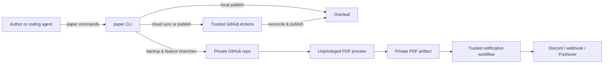

# paper-scripts

`paper-scripts` provides a single command layer (`paper`) for writing LaTeX papers, posters, and slides across local machines, cloud coding agents, GitHub, and Overleaf.

The core workflow revolves around three explicit boundaries:

- **`paper commit`** creates a local checkpoint without pushing anywhere.
- **`paper backup`** pushes committed work to your private GitHub repository and never touches Overleaf.
- **`paper publish`** reconciles fresh remote state and publishes verified manuscript changes to Overleaf.



## Installation

Clone the repository and publish it with `workspace-release` (part of the agents configuration):

```bash
git clone https://github.com/m1gwings/paper-scripts.git ~/Projects/paper-scripts
workspace-release publish ~/Projects/paper-scripts
```

Publishing tests the committed tree, stores it as an immutable release, and links four commands (`paper`, `project-open`, `project-terminal`, and `workspace-edit`) in `~/.local/bin` to that release, as declared in `release.toml`. Uncommitted edits in the checkout never reach the installed commands; publish again after committing a change. Ensure `~/.local/bin` is on your `PATH`.

**Core requirements:**
- Bash, Git, GNU `readlink`, and Python 3.9+ (required for installation and all `paper` commands).
- GitHub CLI (`gh`) for repository creation, CI setup, and cloud workflow dispatch.
- `latexmk` and a TeX distribution for local builds.
- VS Code (`code`) for `--vscode`, or Kitty and Micro for `--terminal`.
- For native Overleaf TeX restoration and page-by-page PDF comparison (`paper tex`): Linux `x86_64`, Python 3.12+, Perl, `curl`, `tar`, `xz`, and Poppler's `pdftoppm`.

## Quickstart

Create a **Blank Project** on Overleaf, copy its project ID or full `https://www.overleaf.com/project/ID` URL, and run:

```bash
paper create OVERLEAF_ID OWNER/my-paper             # default directory: ./paper
paper create --poster OVERLEAF_ID OWNER/my-poster   # default directory: ./poster
paper create --slides OVERLEAF_ID OWNER/my-slides   # default directory: ./slides
```

`paper create` clones Overleaf (using username `git` and an Overleaf Git token generated in Overleaf account settings, separate from your website/SSO password), initializes project infrastructure, commits locally, and pushes to a new **private** GitHub repository. It does not push to Overleaf; inspect the starter and run `paper publish` when ready.

## Everyday workflows

Every paper repository has a collaborative **base branch** (usually `main` or `master`, detected automatically from Overleaf) alongside optional short-lived feature branches.

**Small direct edit:**

```bash
paper sync
paper open
# edit and review locally
paper commit "Clarify the stopping-time argument"
paper publish
```

**Isolated feature branch:**

```bash
paper start new-lower-bound
# edit and build
paper commit "Add the first lower-bound construction"
paper backup
# iterate until ready
paper publish
```

`paper start` syncs the base branch before branching and immediately backs up the new branch to GitHub. `paper publish` fetches fresh state from both remotes, merges your feature into the base branch, pushes to GitHub, publishes the manuscript to Overleaf, and returns you to the base branch while keeping the feature branch intact.

**Cleaning up merged feature branches:**

```bash
paper clear-feature-branches               # list eligibility without deleting
paper clear-feature-branches --all-merged  # delete branches merged into local & GitHub bases
```

**Standalone research notes:**

```bash
paper note new lower_bound --title "Lower Bound Derivation"
paper build notes/lower_bound.tex
paper note list
```

**Resolving merge conflicts:**

If `paper sync` or `paper publish` stops on a conflict:

```bash
git status
# edit conflicted files
git add <resolved-files>
git merge --continue
paper status
```

To abandon the merge instead, run `git merge --abort`.

## Command reference

Run `paper help` for the complete reference and `paper examples` for compact recipes.

### Lifecycle & remotes

| Command | Description |
| --- | --- |
| `paper create [--poster \| --slides] [--force] OVERLEAF_ID OWNER/REPO [DIR]` | Clone an Overleaf project, initialize infrastructure, and create its private GitHub mirror. |
| `paper init [--poster \| --slides] [--force \| --workflow-only]` | Initialize or conservatively upgrade infrastructure inside an existing Git repository. |
| `paper gitignore` | Create the standard paper `.gitignore` if none exists (never overwrites an existing one). |
| `paper sync` | Reconcile GitHub and Overleaf into the local base branch. |
| `paper start NAME` | Sync the base branch, create feature branch `NAME`, and back it up to GitHub. |
| `paper commit "MESSAGE"` | Stage all changes and create a local commit (pushes nowhere). |
| `paper backup` | Push the current committed branch to GitHub without touching Overleaf. |
| `paper publish` | Reconcile remotes, integrate committed work, back up to GitHub, and publish to Overleaf. |
| `paper abort` | Confirm and delete the current feature branch locally and on GitHub. |
| `paper clear-feature-branches [NAME ... \| --all-merged] [--yes] [--dry-run]` | Inspect or safely delete feature branches merged into both local and GitHub bases. |
| `paper status [--verbose]` / `paper doctor` | Inspect manuscript sync state, GitHub backup state, configuration, and required tools. |

### Building, viewing, notes & workspaces

| Command | Description |
| --- | --- |
| `paper build [--watch] [ROOT.tex]` | Compile with `latexmk` into `output/` (default: `main.tex`). Without a root, `--watch` watches all standalone `.tex` documents. |
| `paper watch register \| unregister ROOT [--client NAME] [--pid PID]` | Add or remove a project of the shared build watcher; `paper watch status [--json]` lists them and `paper watch stop` stops it. |
| `paper view [ROOT.tex]` | Build and open the PDF in `workspace-read`, Evince, or the system viewer. |
| `paper clean [ROOT.tex]` | Remove generated build files for the selected document. |
| `paper note new NAME [--title TITLE] [--open] [--force]` | Create a standalone LaTeX note in `notes/<name>.tex` using the project's macros. |
| `paper note list` | List research notes with their titles and build status. |
| `paper tex sync \| capture \| install \| status \| check \| compare-pdf` | Capture, restore, and verify a pinned Overleaf TeX Live environment (see [`docs/tex_environment.md`](docs/tex_environment.md)). |
| `paper open [DIR \| ALIAS] [--terminal \| --vscode]` | Open a paper workspace (see [Local workspaces](#local-workspaces) for `project-open`, `project-terminal`, and `workspace-edit`). |

### Tasks, CI & notifications

| Command | Description |
| --- | --- |
| `paper task status [--all]` / `paper task delete ID ...` | List open/completed task records or move selected tasks (by number or folder name) to `tasks/.trash/`. |
| `paper configure-ci [--environments-only]` | Create protected GitHub Actions environments and store the Overleaf token. |
| `paper configure-notifications [--provider PROVIDER] [--device NAME] [OWNER/REPO ...]` | Configure notification credentials (`discord`, `pushover`, or `webhook`) for one or more repositories. |
| `paper notify --title TITLE --message MESSAGE [--url HTTPS_URL]` | Dispatch a notification through the trusted GitHub Actions workflow. |
| `paper notify-test` | Send a test notification using the configured provider. |

## Project layout, scaffolding, and upgrades

### Repository layout

Every initialized repository gets a self-contained, versioned layout:

```text
AGENTS.md                              project-specific instructions and managed workflow blocks
.paper/config.json                     non-secret project settings
.paper/manifest.json                   managed-file versions and hashes
.paper/WORKFLOW.md                     concise lifecycle contract
.paper/runtime/                        pinned paper-scripts runtime used by CI and local tools
.github/workflows/paper-preview.yml    unprivileged PDF preview build
.github/workflows/paper-notify.yml     trusted notification workflow
.github/workflows/paper-publish.yml    trusted sync and publication workflow
notes/                                 standalone research notes
tasks/                                 task records (NNN_slug/task.md) and task artifacts, created on demand
```

Because `.paper/runtime/` is vendored per repository, updating your local `paper-scripts` checkout never silently changes existing papers. Upgrade a paper explicitly by running `paper init`, reviewing the diff, and committing.

**Task records (`tasks/`):** Multi-step research or writing tasks are tracked by `agents-workspace` checkpoints: the first checkpoint of a task creates `tasks/NNN_slug/task.md` with a generated block (title, status, task ID, objective, current checkpoint, next step), and the folder keeps the task's artifacts. Notes below the block are preserved, and the Git-tracked record lets `agents-workspace resume` import the task on another machine. Without `agents-workspace`, write the same record by hand. Inspect progress with `paper task status` (or `--all`) and recoverably delete tasks by number (e.g., `002`) or folder name with `paper task delete`. `paper init` retires the `tasks/index.md` queue and `tasks/template.md` of older layouts when Git holds them unmodified.

### Scaffolding and upgrades

`paper init` inspects the repository and behaves conservatively:

- **Blank projects** receive a compilable starter (`main.tex`, `content/`, `appendix/`, `algs/`, `figures/`, `tables/`, `references.bib`, `projectmacros.tex`, and `papermacros.sty`) for the chosen document type (`paper`, `poster`, or `slides`). Recognized title, author, and date fields from Overleaf's stock blank `main.tex` are preserved.
- **Existing manuscripts** keep all source files, macros, and bibliography untouched.
- **Upgrades** refresh untouched managed files using manifest hashes, preserve custom files and custom `AGENTS.md` content outside the four marker-managed blocks (see [`templates/README.md`](templates/README.md)), and stop before overwriting edited managed files.
- **`paper init --force`** reinstalls starter paths, saving backups of differing files under `.paper/scaffold-backups/`.
- **`paper init --workflow-only`** upgrades `.paper/runtime/` and `.paper/WORKFLOW.md` without touching manuscript sources, `papermacros.sty`, an existing `AGENTS.md`, or `.github/workflows/`.

### Project settings (`.paper/config.json`)

`.paper/config.json` stores non-secret settings such as `document_type`, `base_branch`, `overleaf_project_id`, `root_tex`, `notify_provider`, `overleaf_exclude`, and a user-editable `project_name` (used for window titles and shell prompts independently of the LaTeX title). Custom fields are preserved across upgrades.

### Editing default templates

Default agent instructions live in [`templates/AGENTS.paper.md`](templates/AGENTS.paper.md), [`templates/AGENTS.poster.md`](templates/AGENTS.poster.md), and [`templates/AGENTS.slides.md`](templates/AGENTS.slides.md). Edit them directly in your `paper-scripts` checkout; new projects use them immediately and existing projects adopt managed-block updates on `paper init`. See [`templates/README.md`](templates/README.md) for the marker-block contract.

### Recovering an interrupted `paper create`

If creation stops midway, inspect `git status`, `git remote -v`, and `gh repo view OWNER/REPO` rather than deleting the directory:

- **Remotes already match:** re-running `paper create` runs conservative `paper init` without overwriting work. Review, commit, and run `paper backup`.
- **Clone finished before remote rename:** verify `origin` points to the intended Overleaf project, then run `git remote rename origin overleaf` and `paper init`.
- **GitHub creation failed:** if `OWNER/REPO` does not exist yet, commit local initialization and run `gh repo create OWNER/REPO --private --source=. --remote=github --push`. If it already exists, verify its history before adding it as the `github` remote.
- **Push failed:** verify the repository state and run `paper backup`, then check with `paper doctor`.

## Building, viewing, and Overleaf parity

`paper build [ROOT.tex]` compiles with `latexmk` and writes the PDF to `output/main.pdf` (or `output/<subdir>/<name>.pdf` for nested roots such as `notes/lower_bound.tex`). Auxiliary files, logs, SyncTeX data, and build status (`output/.latex/<stem>.build.json`) stay hidden inside `output/.latex/`. Keep `/output/` in `.gitignore` rather than ignoring `*.pdf`, so tracked source figures remain versioned.

- **Watch mode (`paper build --watch [ROOT.tex]`):** rebuilds automatically on source or dependency changes. Without a root argument, it discovers and watches all standalone `.tex` documents in the repository (such as `main.tex` and `notes/*.tex`), mirroring their paths under `output/`, and rebuilds whenever any TeX/BibTeX input recorded in `.fls`/`.fdb_latexmk` (including generated figures and symlinks) changes. Builds are serialized by a lock, and failed builds preserve the last valid PDF and SyncTeX map.
- **Shared build watcher (`paper watch`):** one background process per user watches every project open in Editor or Reader exactly as `paper build --watch` does, running each build as a `paper build ROOT.tex` child in its project. Builds of different projects run concurrently, builds within a project stay serialized, and a failing project never affects the others. The daemon starts on the first registration, listens on `$XDG_RUNTIME_DIR/paper/watch.sock`, logs to `~/.local/state/paper/watch.log` (each project's compiler output goes to `output/.latex/.watch.log`), and exits when the last project unregisters. A project stays watched while any client holds it:

  ```bash
  paper watch register ROOT --client editor --pid EDITOR_PID   # idempotent; any path inside the repository
  paper watch register ROOT --client reader --pid READER_PID
  paper watch unregister ROOT --client editor                  # --all drops every client
  paper watch status --json                                    # {"running", "pid", "projects": [{"root", "clients", "state", "building", "sources", "error"}]}
  ```

  With `--pid`, the client is dropped automatically when that process exits. Registration resolves the Git top level, ignores repositories without `.paper/config.json` or standalone `.tex` documents, and records the caller's runtime, whose `build.py` runs the project's builds. A project that a `paper build --watch` process already watches (`output/.latex/.project.watch.lock`) is left to it and taken over once that process stops. A rewritten runtime (for instance after `paper init` upgrades `.paper/runtime`) reloads the daemon in place, keeping its registrations.
- **Viewing (`paper view [ROOT.tex]`):** builds and opens the PDF in `workspace-read` when installed, falling back to Evince or `xdg-open` (override with `PAPER_PDF_VIEWER`).
- **Overleaf compilation parity (`paper tex`):** when the optional `workspace-overleaf` HTTP connector is installed, `paper create`, `paper sync`, `paper publish`, and watch builds automatically capture Overleaf's compiler, TeX Live image, and build outputs, restore a matching frozen native TeX Live environment, and verify rendered page parity without blocking editing. Standalone users can also import an Overleaf compile log manually via `paper tex capture` and `paper tex install`. See [`docs/tex_environment.md`](docs/tex_environment.md) for supported environments, caching, and diagnostics.

## Shared macros and revision tracking

Starter projects share a single agent-neutral package, `templates/latex/papermacros.sty`, while keeping paper-specific notation in `projectmacros.tex`. See [`templates/latex/README.md`](templates/latex/README.md) for package options, rendering modes (`visible`, `applied`, `reverted`), and usage rules.

Core revision commands:

| Operation | Command |
| --- | --- |
| Addition / deletion | `\AgentsIns{new}` · `\AgentsDel{old}` |
| Math replacement | `\AgentsReplaceMath{old}{new}` |
| Review comments | `\Agents[Model Name]{note}` · `\AgentsOut[Model Name]{note}` |

The `visible`, `applied`, and `reverted` package modes control PDF rendering only. Finalizing reviewed edits means updating the `.tex` source to permanently remove `\AgentsDel{...}` content and unwrap `\AgentsIns{...}` content for the agreed scope.

## Synchronization, clean Overleaf exports, and safety

A paper repository connects two remotes alongside optional feature branches:

```text
overleaf/<base>    collaborative manuscript on Overleaf
github/<base>      private mirror and trusted workflow source
github/<feature>   isolated work and backup
```

### Reconciliation rules

`paper start`, `paper sync`, and `paper publish` fetch both remotes before updating the base branch:

1. Fresh GitHub commits are merged into the local base without rewriting history.
2. Fresh Overleaf manuscript changes are merged into the base; identical file trees skip redundant history replays, and conflicts stop for manual resolution.
3. All pushes are standard fast-forward updates—neither GitHub nor Overleaf is ever force-pushed. Overleaf always receives a linear history whose tree matches the verified manuscript export.

`paper clear-feature-branches` lists eligible branches by default. When deleting (`--all-merged` or explicit names), it fetches GitHub first, verifies that both local and remote branch tips are merged into both local and GitHub bases, skips checked-out or unmerged branches, deletes locally with `git branch -d`, and atomically verifies each remote branch has not moved before deleting it on GitHub. It never touches Overleaf.

### Clean Overleaf exports

By default, `.paper/config.json` excludes tooling and private directories from Overleaf while keeping everything on GitHub:

```json
"overleaf_exclude": [".paper/", ".github/", ".codex/", ".agents/", ".vscode/", ".gitignore", "AGENTS.md", "tasks/", "notes/", "tools/", "references/", "README.md"],
"overleaf_exclude_basenames": [".gitkeep"]
```

Paths are repository-relative without globs (`references/` is reading material; `references.bib` stays exported). Set both lists to `[]` for full-tree exports. Commits touching only excluded paths do not create Overleaf commits, and coauthor edits on Overleaf are imported only for manuscript paths.

`paper status` reports manuscript sync against Overleaf separately from GitHub backup status (`--verbose` adds raw commit counts).

## Local workspaces

### Opening projects (`paper open` and `project-open`)

`paper open` opens a paper repository in either VS Code or the terminal Editor (Kitty + Micro + project shell + Build tab following the shared build watcher + PDF viewer). `project-open` provides the same launcher for any directory, including non-Git projects.

```bash
paper open                            # open current paper using configured editor
paper open --terminal                 # Kitty + Micro + PDF viewer; builds via paper watch
paper open --vscode                   # VS Code window
paper open "journal extension"        # resolve a registered project alias (requires workspace-project)
project-open ~/repo/src/main.py       # open the project that owns a file (requires workspace-project)
paper open --hot                      # list recently used projects (requires workspace-project)
project-open --read index.md DIR      # open Markdown in workspace-read with a minimized editor
```

`paper open` defaults to `vscode` (override via `git config [--global] paper.editor terminal`, `PAPER_EDITOR`, or `--terminal`/`--vscode`); `project-open` defaults to `terminal`.

**One Editor for all projects.** Terminal opens, `workspace-edit` and `project-terminal` route into a single Editor window (one Kitty process with a private socket, `$XDG_RUNTIME_DIR/project-workspaces/editor.sock`, app ID `workspace-editor`), starting it when absent. One Micro process holds every project's files. Its window title is `Editor — <active project name>`.

- **Project shells.** Each project has its own shell, started on the project's first activation. The active project's shell sits below Micro; the others wait, alive, in a hidden tab (Kitty's `tab_bar_filter` hides it and tab navigation skips it). Switching projects moves panes in one in-process Kitty call, drawn once: about 3–5 ms inside Kitty, about 30 ms end to end from the hook. The split height and a hidden terminal (Ctrl+\`) carry over. Scrollback is capped at 2000 lines per pane.
- **Task tabs** (`project-terminal run`, Build, Experiments, SSH) belong to their project: each Kitty pane carries the user variable `workspace_project=<root>`, and a new tab joins the end of its project's group. LaTeX projects get a `Build` tab that follows the shared build watcher's output (`output/.latex/.watch.log`).
- **Micro's project hook.** Micro calls `$WORKSPACE_EDITOR_PROJECT_HOOK` (`lib/editor_hook.py`) in the background: `HOOK ROOT` when the active tab's project changes (empty for a Loose file), `--opened ROOT` and `--closed ROOT` when a project gains its first or loses its last tab (registering it with, or unregistering it from, `paper watch`), and `--busy ROOT`, which prints what runs in the project's shell or task tabs before Micro asks to close it.
- **Coming forward.** `workspace-edit show-project ROOT` focuses the project in Micro and swaps in its shell without activating the window; `project-terminal activate ROOT` and `project-terminal close-project ROOT [--force]` act on the shells alone.
- `--new` opens a separate per-project Editor window. Per-project Editors opened by earlier releases keep working until closed and still serve their explicit `--session`.

In the Editor:
- **Ctrl+\`** toggles the bottom shell split (preserving running processes and split height).
- **Ctrl+Alt+Arrows** moves between panes; **Ctrl+Shift+Z** zooms/restores the active pane; **Ctrl+Shift+R** resizes (Kitty's built-in resize shortcut); **Ctrl+Shift+Enter** adds a shell split.
- Pass `--focus` to activate the workspace window immediately (standalone installations without `workspace-desktop` need `--focus` to show the terminal window unminimized).
- Optional user-level placement hooks can be configured in `~/.config/project-open/config.json` via `{"post_open": ["/path/to/hook"]}` (bypass with `--no-post-open`).

### Adding task terminals (`project-terminal`)

Add tabs, splits, or shared bottom docks to the Editor (or a per-project window) without injecting keystrokes into active panes:

```bash
project-terminal list
project-terminal toggle [--show | --hide]
project-terminal run --project /path/to/paper --title Experiments --cwd /path/to/exp -- ./run.sh
project-terminal run --project /path/to/paper --dock --title Shell
```

Pass `--split` to split the editor tab (an inactive project's split waits with its shell), `--tab ID` to target a tab of a per-project window, `--dock` (requires Kitty 0.51+) for a resizable bottom dock shared across tabs, or `--focus` to switch focus. Commands run with literal arguments and drop to an interactive Bash shell on exit (wrap shell pipelines in `-- bash -lc '...'`).

### Guarded live editor control (`workspace-edit`)

When Micro runs with the companion mailbox plugin, `workspace-edit` communicates with live editor buffers over a private local mailbox without simulating keyboard input:

```bash
workspace-edit list --json
workspace-edit DIRECTORY [FILE ...] --line 42 --column 1
workspace-edit show-project ROOT
workspace-edit view FILE --line 42 --end-line 48 --highlight
workspace-edit status FILE --json
workspace-edit read FILE --line 1 --end-line 80 --json
workspace-edit apply FILE --expected-version SHA256 --edits-file edits.json
workspace-edit save FILE --expected-version SHA256
workspace-edit reload FILE [--discard --expected-version SHA256]
```

`status` and `read` return live buffer metadata and a SHA256 `version` over the complete buffer. `apply` performs one atomic, undoable edit without saving (JSON array of one-based `{"start":{"line":1,"column":1},"end":{"line":1,"column":4},"text":"..."}` objects), and `save` writes through the editor while preserving undo history and cursor state. Both reject stale versions, disk conflicts, or read-only buffers.

### Optional companion integrations

All core lifecycle, build, note, task, cloud, and terminal-launching commands work standalone. When present on `PATH`, optional external companion tools activate extra capabilities:

| Companion | Activated capabilities |
| --- | --- |
| `workspace-read` | Native live-reloading PDF and Markdown viewer (`paper view`, `paper open`, `project-open --read`). Falls back to Evince or `xdg-open` for PDFs. |
| `workspace-project` | Project alias resolution (`paper open "alias"`), the project owning a file path, `--hot`, and `--list`. |
| `workspace-overleaf` | Automatic Overleaf HTTP capture and background parity checks (`paper tex sync`). |
| `agents-workspace` | Task records written from durable checkpoints (`tasks/NNN_slug/task.md`) and cross-machine task import. |
| `workspace-desktop` | Passive window reveal without stealing keyboard focus when opening or reusing terminal workspaces. |
| Micro mailbox plugin | Workspace reuse, live buffer inspection, and guarded edits (`workspace-edit list/status/read/apply/save/reload/view`). |

## Cloud workflow and notifications

### Cloud execution

By default (`paper.execution=auto`), `paper` automatically switches to cloud mode when no `overleaf` remote is configured. To force cloud mode explicitly in a sandbox that only has GitHub access:

```bash
git config paper.execution cloud
```

(Or set `PAPER_EXECUTION=cloud` in the environment.) Provide `GH_TOKEN` as a secret environment variable with GitHub Contents write and Actions read/write permissions (never paste it into chat, commits, or remote URLs). Cloud `paper sync` and `paper publish` dispatch trusted workflows from GitHub's default branch, verify that the reviewed branch SHA has not changed, and refuse feature-branch edits to `.paper/` or `.github/`. Cloud agents never receive Overleaf or notification credentials.

### Secrets and protected environments

Generated GitHub Actions workflows enforce a strict trust boundary on the default branch:

| Environment | Secrets | Purpose |
| --- | --- | --- |
| `paper-publish` | `OVERLEAF_TOKEN` | Fresh synchronization and explicit Overleaf publication. |
| `paper-notify` | `DISCORD_WEBHOOK_URL` (or selected provider secret) | Manual, preview, and publication notifications. |

Run `paper configure-ci` once per repository to create both protected environments and store `OVERLEAF_TOKEN` via hidden prompt. Protected environments on private GitHub repositories require repository admin access and a GitHub plan supporting private environments (Pro, Team, Education, or Enterprise).

### PDF previews and notifications

The `paper-preview` workflow compiles `root_tex` without secrets and uploads `paper.pdf` as a private GitHub Actions artifact (14-day retention). The trusted `paper-notify` workflow sends notifications linking directly to that artifact, and can also be invoked manually:

```bash
paper notify --title "Proof audit complete" \
  --message "The revised argument and checked PDF are ready." \
  --url "https://github.com/OWNER/REPOSITORY/actions/runs/RUN_ID/artifacts/ARTIFACT_ID"
```

**Setting up Discord (default):**
1. In your Discord channel, open **Edit Channel → Integrations → Webhooks → New Webhook** and copy the webhook URL.
2. From a private terminal inside the paper repository, run:
   ```bash
   paper configure-notifications --provider discord
   ```
   Paste the webhook URL at the hidden prompt (pass multiple `OWNER/REPO` arguments to configure several repositories at once).
3. Test delivery with `paper notify-test`.

`paper configure-notifications` also supports `--provider webhook` (generic JSON `{title, message, url}` via `PAPER_NOTIFY_WEBHOOK_URL`) and `--provider pushover` (`PAPER_PUSHOVER_USER_KEY`, `PAPER_PUSHOVER_APP_TOKEN`, and optional `--device NAME`). To disable notifications, set `"notify_provider": "none"` in `.paper/config.json` (or `PAPER_NOTIFY_PROVIDER=none` in GitHub). Automatic preview notifications skip without failing (emitting an Actions notice) when no provider credentials are configured; explicit `paper notify` calls require valid credentials.

## Validation

Run the test suite from the `paper-scripts` root:

```bash
bash -n paper project-open project-terminal workspace-edit lib/create.sh
python3 -m unittest discover -s tests -v
```
